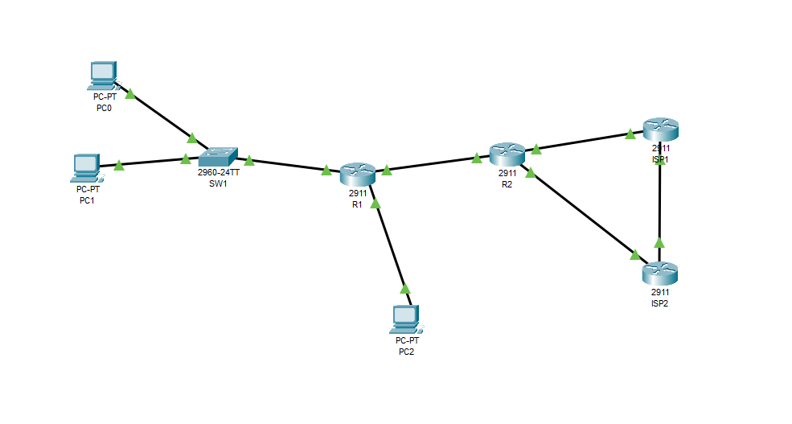

# Отчет по лабораторной работе №1.1
**Тема:** Базовая настройка, ARP, статическая маршрутизация
**Выполнил:** Канайкин А. А., гр. 409 

## Топология



## Ответы на вопросы

### Часть 1: Создание топологии и начальная конфигурация устройств

**Вопрос 1.** Проверьте связность, отправив эхо-запросы (`ping`) с PC0 на PC1 (`192.168.0.101`) и PC2 (`192.168.1.102`). Приведите результат. Приведите таблицу коммутации на SW1 после проверки (`show mac address-table`). Приведите таблицу ARP на PC0 (`arp -a`) и на R1 (`show ip arp`).

**Ответ:** Пинг с PC0 до PC1 (`192.168.0.101`) проходит успешно (оба в одной подсети). Пинг с PC0 до PC2 (`192.168.1.102`) также проходит успешно (маршрутизация через R1).

**Таблица коммутации на SW1:**
```text
SW1# show mac address-table
SW1# show mac address-table
          Mac Address Table
-------------------------------------------
Vlan    Mac Address       Type        Ports
----    -----------       --------    -----
   1    0000.0c8e.d201    DYNAMIC     Gig0/1
   1    00e0.f79b.81c8    DYNAMIC     Fa0/10
```

**Вопрос 2.** Изучите сообщение на PC0. MAC-адрес какого устройства указан в DEST MAC Ethernet-кадра? Почему?

**Ответ:** В DEST MAC (Destination MAC) указан MAC-адрес **шлюза по умолчанию (Router0 / R1, интерфейс Gi0/0)**. 

**Почему:** PC0 и PC2 находятся в разных подсетях (`192.168.0.0/24` и `192.168.1.0/25`). PC0 понимает, что PC2 не в его локальной сети, поэтому он отправляет пакет своему шлюзу (R1) для дальнейшей маршрутизации. На уровне Ethernet (L2) адресом назначения всегда будет MAC-адрес следующего hop (устройства) на пути к цели, а не конечного получателя (PC2).

**Вопрос 3.** Пролистайте `Events` до момента, когда сообщение достигнет R1. Изучите `Outbound PDU Details`. SRC и DEST MAC-адреса каких устройств указаны в Ethernet-кадре? Почему?

**Ответ:** Когда пакет покидает R1 (Outbound PDU) в сторону PC2:
*   **SRC MAC (Source MAC):** MAC-адрес интерфейса **R1 Gi0/1** (через который пакет уходит в сторону LAN2).
*   **DEST MAC (Destination MAC):** MAC-адрес **PC2** (конечного получателя в этой сети).

**Почему:** Маршрутизатор R1 принял пакет от PC0, «снял» старый Ethernet-кадр (где destination был MAC-адрес самого R1), проверил IP-адрес назначения (PC2) и, определив, что PC2 находится в подключенной сети LAN2, создал **новый** Ethernet-кадр. В этом новом кадре источником (SRC) является сам R1 (его интерфейс Gi0/1), а пунктом назначения (DEST) — конечное устройство PC2. Это демонстрирует, как маршрутизатор меняет L2-заголовки при пересылке пакетов между сетями.

**Вопрос 4.** Изучите сообщение протокола ARP, созданное на PC0 и ответьте на вопросы:

**Ответ:** 
1. **Какой TYPE указан в Ethernet-кадре?** 
   Тип `0x0806` (ARP).
2. **Какой DEST MAC-адрес указан в Ethernet-кадре? Как он называется? Как поступит SW1, когда получит этот кадр?** 
   DEST MAC — `FF:FF:FF:FF:FF:FF` (широковещательный/broadcast). SW1 получит этот кадр и отправит его во все порты (кроме того, откуда он пришел), так как это широковещательный трафик.
3. **Какой OPCODE указан в заголовке ARP?** 
   OPCODE `1` (ARP Request / Запрос).
4. **SOURCE MAC и SOURCE IP какого устройства указаны в заголовке ARP?** 
   SOURCE MAC — MAC-адрес PC0, SOURCE IP — `192.168.0.100` (адрес PC0).
5. **Какой TARGET MAC? Почему?** 
   TARGET MAC — `00:00:00:00:00:00` (пустой/неизвестный). Потому что PC0 знает IP-адрес шлюза (192.168.0.1), но еще не знает его MAC-адрес, именно для его получения он и отправляет ARP-запрос.

**Вопрос 5.** Пролистайте `Events` до момента, когда сообщение достигнет R1. Изучите `Outbound PDU Details` и ответьте на вопросы:

**Ответ:** 
1. **DEST MAC-адрес какого устройства указан в Ethernet-кадре? Как поступит SW1, когда получит этот кадр?** 
   DEST MAC — **MAC-адрес PC0**. SW1 получит этот кадр и отправит его **только в конкретный порт**, к которому подключен PC0 (это уже не широковещательный, а одноадресный/unicast кадр).
2. **Какой OPCODE указан в заголовке ARP?** 
   OPCODE **`2`** (ARP Reply / Ответ).
3. **Кому принадлежат SOURCE MAC, SOURCE IP и TARGET MAC, TARGET IP?** 
   *   SOURCE MAC / IP: **MAC и IP роутера R1** (`192.168.0.1`).
   *   TARGET MAC / IP: **MAC и IP компьютера PC0** (`192.168.0.100`).

**Вопрос 6.** Посмотрите таблицу маршрутизации на R2 (`show ip route`). Какой Next-hop указан для маршрута по умолчанию?

**Ответ:** Next-hop для маршрута по умолчанию (`S* 0.0.0.0/0`) указан **`100.0.102.129`** (адрес ISP1). Это основной маршрут с административной дистанцией 1 (по умолчанию), который используется для выхода во внешнюю сеть.

```text
R2# show ip route
Codes: L - local, C - connected, S - static, R - RIP, M - mobile, B - BGP
       D - EIGRP, EX - EIGRP external, O - OSPF, IA - OSPF inter area
       N1 - OSPF NSSA external type 1, N2 - OSPF NSSA external type 2
       E1 - OSPF external type 1, E2 - OSPF external type 2, E - EGP
       i - IS-IS, L1 - IS-IS level-1, L2 - IS-IS level-2, ia - IS-IS inter area
       * - candidate default, U - per-user static route, o - ODR
       P - periodic downloaded static route

Gateway of last resort is 100.0.102.129 to network 0.0.0.0

     10.0.0.0/8 is variably subnetted, 2 subnets, 2 masks
C       10.10.12.0/30 is directly connected, GigabitEthernet0/2
L       10.10.12.1/32 is directly connected, GigabitEthernet0/2
     100.0.0.0/8 is variably subnetted, 4 subnets, 2 masks
C       100.0.102.128/30 is directly connected, GigabitEthernet0/0
L       100.0.102.130/32 is directly connected, GigabitEthernet0/0
C       100.0.202.128/30 is directly connected, GigabitEthernet0/1
L       100.0.202.130/32 is directly connected, GigabitEthernet0/1
S    192.168.0.0/22 [1/0] via 10.10.12.2
S*   0.0.0.0/0 [1/0] via 100.0.102.129
```

**Вопрос 7.** Посмотрите таблицу маршрутизации на R2 (`show ip route`). Какой Next-hop указан теперь для маршрута по умолчанию?

**Ответ:** После выключения интерфейса Gi0/0 (имитация аварии на основном канале), Next-hop для маршрута по умолчанию изменился на **`100.0.202.129`** (адрес ISP2). Сработал **плавающий статический маршрут** с административной дистанцией 10. Когда основной маршрут через ISP1 стал недоступен, роутер автоматически переключился на резервный маршрут через ISP2.

```text
R2# show ip route
Gateway of last resort is 100.0.202.129 to network 0.0.0.0

     10.0.0.0/8 is variably subnetted, 2 subnets, 2 masks
C       10.10.12.0/30 is directly connected, GigabitEthernet0/2
L       10.10.12.1/32 is directly connected, GigabitEthernet0/2
     100.0.0.0/8 is variably subnetted, 2 subnets, 2 masks
C       100.0.202.128/30 is directly connected, GigabitEthernet0/1
L       100.0.202.130/32 is directly connected, GigabitEthernet0/1
S    192.168.0.0/22 [1/0] via 10.10.12.2
S*   0.0.0.0/0 [10/0] via 100.0.202.129